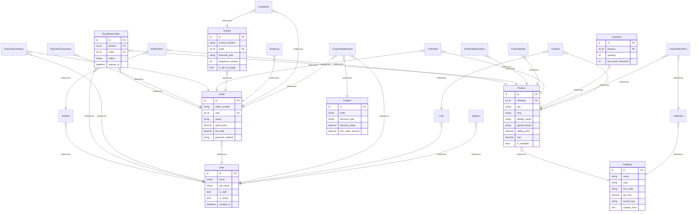

# ELECTROCART Database Guide: Architectural Reference & Non-Developer Handbook (WP1)

This guide is written for university faculty, project evaluators, and system administrators. It explains the local database architecture, storage format, data inspection tools, backup mechanisms, reset procedures, and complete table-by-table schema.

---

## 1. Physical Location and File Security

- **File Path:** `<PROJECT_ROOT>/db.sqlite3` (e.g. `c:\Users\PRASHANT\Downloads\RootDirectory\db.sqlite3`)
- **Engine:** `django.db.backends.sqlite3` (SQLite 3.45+)
- **File Size:** ~13.4 MB (7,149 catalog specimens, 6,769 inventory records, 40 relational tables)
- **Why no database password exists:**
  SQLite is a serverless, embedded database engine. Unlike client-server RDBMS (PostgreSQL, MySQL) which listen on network TCP ports and authenticate client connections over sockets, SQLite stores the entire relational database inside a single file on the local filesystem. Access control is enforced directly by operating system filesystem permissions (read/write access to `db.sqlite3`). There is no listener port, no network attack surface, and no hardcoded database credentials required for local execution.

---

## 2. Four Ways to View and Query the Database

ELECTROCART provides four distinct interfaces to inspect data, ranging from non-developer web UIs to direct SQL consoles:

### Method A: Automated Summary CLI (`scripts/db_summary.py`)
Run the audit script in your terminal to see engine configuration, PRAGMA health checks, row counts for all tables, and subsystem seed statuses:
```powershell
python scripts/db_summary.py
```

### Method B: Read-Only Query CLI (`scripts/db_viewer.py`)
Safe command-line interface that allows non-developers to list tables, view records, and test SELECT queries while strictly blocking all mutations (`INSERT`, `UPDATE`, `DELETE`, `DROP`):
```powershell
# 1. List all 40 tables with row counts
python scripts/db_viewer.py --tables

# 2. View the first 5 records of any table
python scripts/db_viewer.py --table catalog_category --limit 5
python scripts/db_viewer.py --table orders_order --limit 5

# 3. Execute safe read-only SQL queries
python scripts/db_viewer.py --query "SELECT name, slug, gst_rate FROM catalog_category;"
```

### Method C: Visual GUI Inspection with DB Browser for SQLite
[DB Browser for SQLite](https://sqlitebrowser.org/) is a free, open-source graphical tool ideal for visual demonstration:
1. Download and open **DB Browser for SQLite**.
2. Click **Open Database** (Ctrl+O).
3. Navigate to the project root and select `db.sqlite3`.
4. Click the **Browse Data** tab and choose any table (e.g. `catalog_product`, `orders_order`, `inventory_inventory`) from the dropdown.
5. Click **Execute SQL** tab to run ad-hoc queries.

### Method D: Django Interactive Shell & Admin
- **Interactive Python Shell:**
  ```powershell
  python manage.py shell
  ```
  ```python
  from apps.catalog.models import Product
  print(Product.objects.count())
  ```
- **Web Administrator Interface:**
  Start the server with `python manage.py runserver` and open `http://127.0.0.1:8000/admin/`.

---

## 3. Database Health and Integrity Verification

ELECTROCART enforces SQLite pragmas for structural integrity and relational consistency:
- **`PRAGMA integrity_check;`**: Verifies that B-tree structures, freelists, and pages are uncorrupted. (Returns `ok`).
- **`PRAGMA foreign_key_check;`**: Validates all foreign key constraints across the 40 tables. (Returns 0 violations).

You can run these checks directly via SQLite shell:
```powershell
python manage.py dbshell
```
```sql
PRAGMA integrity_check;
PRAGMA foreign_key_check;
.exit
```

---

## 4. How to Back Up the Database

ELECTROCART features an automated, non-blocking online backup command using the official SQLite Online Backup API:
```powershell
# Create a point-in-time timestamped backup in backups/
python manage.py db_backup

# Specify a custom directory or retention limit (default: retains 7 latest archives)
python manage.py db_backup --output-dir C:\backups --retention 14
```
The backup creates `electrocart_backup_YYYYMMDD_HHMMSS.sqlite3` safely while the application is actively serving requests, with zero table locks.

---

## 5. How to Reset and Reseed from Scratch

To restore the store to a clean baseline state:

```powershell
# Step 1: Delete existing SQLite database
Remove-Item db.sqlite3 -Force

# Step 2: Run idempotent demo setup command
python manage.py setup_demo --admin-email admin@electrocart.test --admin-password "ExamDemo2026!"
```

The idempotent `setup_demo` command automatically:
1. Executes all 42 Django migrations.
2. Seeds the 10 monograph product categories with verified HSN codes and GST rates.
3. Imports the raw catalog dataset (`data/electronics_product.csv`) if present.
4. Seeds demo inventory (on-hand physical stock per SKU).
5. Seeds courier delivery zones and sample promotional coupons (`WELCOME10`, `SAVE50`, `FLAT500`).
6. Curates home and category collections.
7. Rebuilds catalog search vectors.
8. Configures administrator and staff manager accounts.

---

## 6. Table-by-Table Schema Reference

The database consists of 40 relational tables grouped into 9 functional subsystems:

| Subsystem | Table Name | Purpose & Contents |
| :--- | :--- | :--- |
| **Accounts** | `accounts_user` | Custom user model (`AUTH_USER_MODEL`) with UUID, email PK identifier, staff/superuser flags. |
| **Accounts** | `accounts_address` | Customer delivery addresses with Indian PIN code, state, landmark, and phone. |
| **Accounts** | `account_emailaddress` | `django-allauth` verified email address tracking and primary email flag. |
| **Catalog** | `catalog_category` | 10 product monograph categories, HSN codes (8518, 8517, etc.), GST rates, and accent palettes. |
| **Catalog** | `catalog_product` | Canonical products with SKU, title, brand, selling price, MRP, ratings, and purchasability. |
| **Catalog** | `catalog_productmedia` | Product photo URLs, local cached images, dimensions, and presentation order. |
| **Catalog** | `catalog_productspecification`| Technical attributes (frequency response, impedance, battery life, weight). |
| **Catalog** | `catalog_collection` | Curated editorial placements (`Home Hero`, `Home Chapter`, `Category Spread`). |
| **Catalog** | `catalog_featuredproduct` | Join table connecting curated collections to specific products with callouts. |
| **Inventory** | `inventory_inventory` | On-hand physical stock quantity and low-stock alert thresholds per SKU. |
| **Inventory** | `inventory_stockreservation`| TTL stock reservation holds (15-min cart, 30-min checkout) to prevent overselling. |
| **Cart** | `cart_cart` | Shopping bag container linked to authenticated user or anonymous session token. |
| **Cart** | `cart_cartitem` | Line items inside a bag with quantities. |
| **Orders** | `orders_order` | Master order record with unique sequential order number (`EC-YYYY-XXXX-XXXX`), status, and delivery address snapshot. |
| **Orders** | `orders_orderitem` | Immutable line item snapshots with unit price, tax rate, allocated discount, and taxable value. |
| **Orders** | `orders_orderstatushistory`| Audit trail of order status transitions (`pending` -> `confirmed` -> `shipped` -> `delivered`). |
| **Orders** | `orders_invoicecounter` | Atomic counter maintaining gap-free financial year series (`EC-INV-YYYY-YY-XXXXX`). |
| **Orders** | `orders_invoice` | Statutory Indian tax invoices (or Bills of Supply) with PDF rendering metadata. |
| **Orders** | `orders_creditnote` | Formal GST Credit Notes for cancelled or refunded orders. |
| **Orders** | `orders_emaillog` | Log of transactional customer notifications with dispatch timestamp and delivery status. |
| **Payments** | `payments_paymenttransaction`| Gateway transaction records (Razorpay order ID, payment ID, signature, status). |
| **Payments** | `payments_webhookevent` | Idempotent webhook event receipt log preventing duplicate processing. |
| **Promotions** | `promotions_coupon` | Discount coupons with percentage/fixed value, usage limits, and expiration windows. |
| **Promotions** | `promotions_couponredemption` | Audit log of individual customer coupon redemptions. |
| **Shipping** | `shipping_shippingconfig`| Singleton configuration for free shipping threshold (₹499) and standard fee. |
| **Shipping** | `shipping_shippingzone` | Regional courier delivery zones mapped to 2-digit PIN prefixes with transit estimates. |
| **Shipping** | `shipping_pincodeserviceability`| Specific 6-digit PIN overrides for courier serviceability and COD eligibility. |
| **Wishlist** | `wishlist_wishlist` | Saved items list linked to user or guest session token. |
| **Wishlist** | `wishlist_wishlistitem` | Products saved in customer wishlists. |

---

## 7. Entity-Relationship Diagram (ERD)

Generated directly from active Django models by `scripts/generate_erd.py`:


